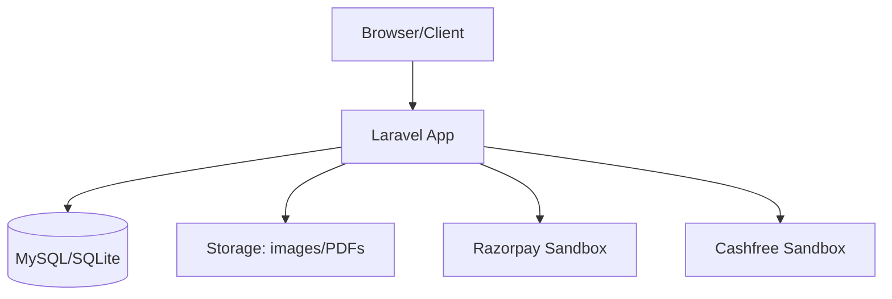
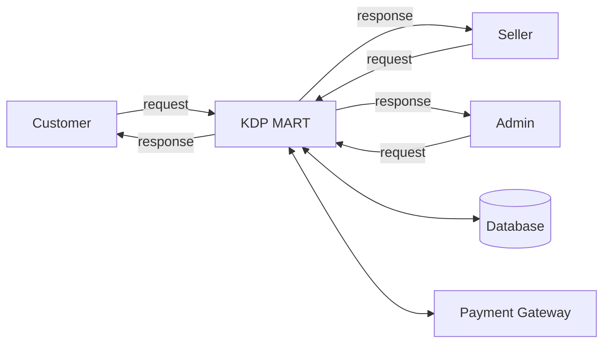
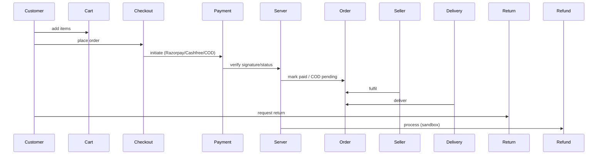

# KDP MART — Diagrams

## System Architecture (Mermaid)

## Use Case Diagram (actors)
- Customer: browse, cart, checkout, orders, returns, wallet, wishlist.
- Seller: manage products, orders, returns, payments, reports.
- Delivery Partner: assigned deliveries, status updates.
- Admin: users, products, orders, coupons, reports, settings.

## DFD Level 0

## ER Diagram (key entities)
User ||--o{ Product : owns
User ||--o{ Order : places
Order ||--|{ OrderItem : contains
Product ||--o{ OrderItem
User ||--|| SmartWallet
SmartWallet ||--o{ SmartCoinTransaction
Order ||--o{ Refund
Order ||--o{ ReturnRequest
User ||--o{ Address

## Order & Payment Workflow

